<picture>
  <source media="(prefers-color-scheme: dark)" srcset="./assets/banner-dark.svg" />
  
</picture>

  
  
  

I'm Mert, also known as **physic**. I build products end to end: the web app, the API behind it, and the desktop and mobile clients on top. Most of that work goes into **[Anysola](https://www.anysola.com)**, a growing set of apps, self-hosted tools and a terminal coding agent.

Ask me about React, Next.js, Node.js, Electron or Tauri. I care about clean code, fast feedback and shipping things people actually use.

## Building now

| Project | What it does | Stack |
| :-- | :-- | :-- |
| **[Anysola Code](https://github.com/Anysola/code)** | A coding agent for your terminal, based on OpenCode. [anysola.com/code](https://www.anysola.com/code) | TypeScript |
| **[code-action](https://github.com/Anysola/code-action)** | Anysola Code on GitHub Actions: pull request reviews and issue-to-PR runs. | Shell |
| **[Mailwick](https://github.com/Anysola/mailwick)** | Self-hosted webmail for any IMAP/SMTP server. Material 3, 30 languages, one container. | TypeScript |
| **[Brimfall](https://github.com/Anysola/brimfall)** | Self-hosted dashboard for Backblaze B2 and S3-compatible storage. Material 3, 30 languages, one container. | TypeScript |
| **[hp-omen-bo-linux-audio](https://github.com/iphysicc/hp-omen-bo-linux-audio)** | The Windows "Audio by B&O" speaker sound for HP OMEN laptops (ALC245) on Linux, via a measured PipeWire convolver. | Python |

## Toolbox

<table>
  <tr>
    <td width="140"><b>Languages</b></td>
    <td></td>
  </tr>
  <tr>
    <td><b>Frameworks</b></td>
    <td></td>
  </tr>
  <tr>
    <td><b>Data &amp; infra</b></td>
    <td></td>
  </tr>
  <tr>
    <td><b>Workspace</b></td>
    <td></td>
  </tr>
</table>

## Activity

  <picture>
    <source media="(prefers-color-scheme: dark)" srcset="https://streak-stats.demolab.com/?user=iphysicc&disable_animations=true&hide_border=true&background=00000000&ring=8075FF&fire=8075FF&currStreakLabel=8075FF&stroke=30363D&currStreakNum=E6EDF3&sideNums=E6EDF3&sideLabels=8B949E&dates=8B949E" />
    
  </picture>

<i>Code with passion, debug with patience.</i>

